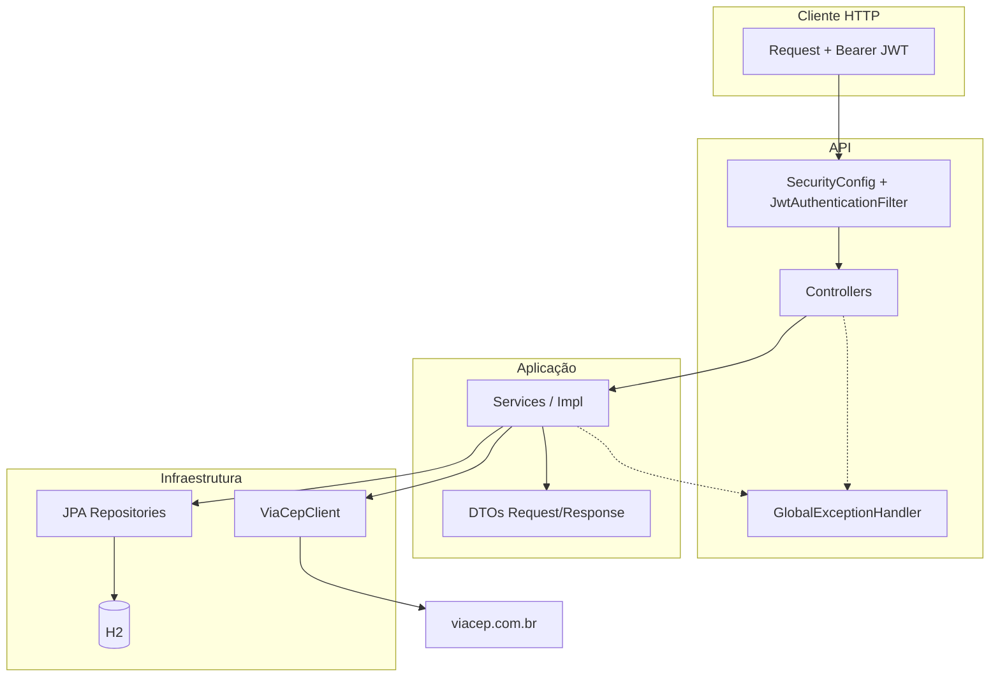
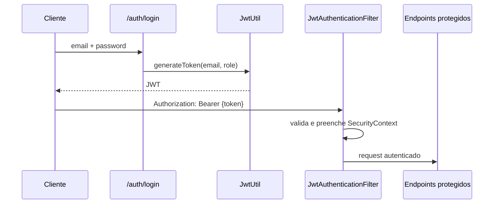

# Clinic API

API REST para gerenciamento de consultórios médicos: cadastro de usuários, médicos, pacientes e agendamento de consultas, com autenticação JWT e controle de acesso por perfis (**ADMIN**, **MEDICO**, **CLIENTE**).

---

## Sumário

- [Funcionalidades](#funcionalidades)
- [Stack tecnológica](#stack-tecnológica)
- [Arquitetura](#arquitetura)
- [Pré-requisitos](#pré-requisitos)
- [Configuração e execução](#configuração-e-execução)
- [Autenticação](#autenticação)
- [Perfis e permissões](#perfis-e-permissões)
- [Endpoints](#endpoints)
- [DTOs de resposta](#dtos-de-resposta)
- [Tratamento de erros](#tratamento-de-erros)
- [Banco de dados](#banco-de-dados)
- [Integração ViaCEP](#integração-viacep)
- [Documentação interativa (Swagger)](#documentação-interativa-swagger)
- [Estrutura do projeto](#estrutura-do-projeto)
- [Testes](#testes)
- [Roadmap sugerido](#roadmap-sugerido)

---

## Funcionalidades

- **Autenticação JWT** com login e registro público (cliente) ou administrativo (médico/admin).
- **CRUD** de médicos, pacientes, usuários e consultas.
- **Regras de negócio** por perfil (visibilidade e alteração de dados no service layer).
- **Validação de CEP** via API pública [ViaCEP](https://viacep.com.br/).
- **DTOs de resposta** para não expor entidades JPA (`password`, `idUser`, relacionamentos internos).
- **Tratamento global de exceções** com códigos HTTP consistentes.
- **Migração Flyway** com usuário administrador inicial.
- **Console H2** para inspeção do banco em desenvolvimento.

---

## Stack tecnológica

| Tecnologia | Versão / uso |
|------------|----------------|
| Java | 21 |
| Spring Boot | 3.4.5 |
| Spring Security | JWT + `@PreAuthorize` |
| Spring Data JPA | Persistência |
| Spring Cloud OpenFeign | Cliente ViaCEP |
| H2 Database | Banco em memória (dev/test) |
| PostgreSQL | Suporte em produção |
| Flyway | Migrações SQL (multi-db) |
| JJWT | Geração/validação de token |
| Lombok | Redução de boilerplate |
| SpringDoc OpenAPI | Swagger UI |
| Maven | Build e dependências |

---

## Arquitetura

Camadas em pacote único `com.clinic_api`:



**Fluxo de autenticação:**



---

## Pré-requisitos

- **JDK 21** instalado e no `PATH`
- **Maven 3.9+** (ou use o wrapper `./mvnw` incluído no projeto)
- Variáveis de ambiente para JWT (obrigatórias)

---

## Configuração e execução

### 1. Variáveis de ambiente

| Variável | Descrição | Exemplo |
|----------|-----------|---------|
| `JWT_SECRET` | Chave secreta para assinar o JWT (mín. 32 caracteres recomendado) | `minha-chave-super-secreta-com-32-chars` |
| `JWT_EXPIRATION` | Tempo de expiração do token em **milissegundos** | `86400000` (24 h) |

**Windows (PowerShell):**

```powershell
$env:JWT_SECRET="sua-chave-secreta-aqui-minimo-32-caracteres"
$env:JWT_EXPIRATION="86400000"
```

**Linux / macOS:**

```bash
export JWT_SECRET="sua-chave-secreta-aqui-minimo-32-caracteres"
export JWT_EXPIRATION=86400000
```

### 2. Executar a aplicação

```bash
# Com Maven instalado
mvn spring-boot:run

# Ou com wrapper
./mvnw spring-boot:run        # Linux/macOS
.\mvnw.cmd spring-boot:run    # Windows
```

A API sobe em **`http://localhost:8080`**.

### 3. Executar com PostgreSQL (produção)

**Variáveis de ambiente adicionais:**

```powershell
# Windows (PowerShell)
$env:SPRING_PROFILES_ACTIVE="prod"
$env:DATABASE_URL="jdbc:postgresql://localhost:5432/clinic_api"
$env:DATABASE_USERNAME="postgres"
$env:DATABASE_PASSWORD="sua_senha"
```

Ou no arquivo `.env` / docker-compose:
```env
SPRING_PROFILES_ACTIVE=prod
DATABASE_URL=jdbc:postgresql://localhost:5432/clinic_api
DATABASE_USERNAME=postgres
DATABASE_PASSWORD=sua_senha
JWT_SECRET=sua-chave-super-secreta-com-32-caracteres
JWT_EXPIRATION=86400000
```

Depois execute:
```bash
./mvnw.cmd spring-boot:run
```

A aplicação usará PostgreSQL, sem console H2, sem logs SQL e com validação de schema (DDL-safe).

### 4. Compilar sem rodar

```bash
mvn clean package -DskipTests
java -jar target/clinic-api-0.0.1-SNAPSHOT.jar
```

### 5. Usuário administrador inicial (Flyway)

Após o primeiro start, existe um usuário seed criado em `src/main/resources/db/migration/V1__create_admin.sql`:

| Campo | Valor |
|-------|--------|
| E-mail | `admin@clinic.com` |
| Role | `ADMIN` |
| Senha | Hash BCrypt definido na migration (defina/ajuste conforme seu ambiente de desenvolvimento) |

> **Dica:** Para testes rápidos, faça login com esse usuário após alinhar a senha com o hash da migration, ou cadastre novos usuários via `/auth/register` e `/auth/admin/register`.

---

## Autenticação

Endpoints públicos (sem token):

- `POST /auth/login`
- `POST /auth/register`

Demais rotas exigem header:

```http
Authorization: Bearer {seu-jwt}
```

### Login

```http
POST /auth/login
Content-Type: application/json

{
  "email": "admin@clinic.com",
  "password": "sua-senha"
}
```

**Resposta (200):**

```json
{
  "token": "eyJhbGciOiJIUzI1NiIsInR5cCI6IkpXVCJ9..."
}
```

### Registro público (CLIENTE)

Cria usuário com role `CLIENTE`, endereço (ViaCEP) e registro de paciente vinculado.

```http
POST /auth/register
Content-Type: application/json

{
  "email": "cliente@email.com",
  "password": "senha123",
  "nome": "João Silva",
  "cep": "01310100",
  "numero": "100"
}
```

### Registro administrativo (ADMIN autenticado)

```http
POST /auth/admin/register
Authorization: Bearer {token-admin}
Content-Type: application/json

{
  "email": "medico@clinic.com",
  "password": "senha123",
  "nome": "Dr. Ana",
  "cep": "01310100",
  "numero": "200",
  "role": "MEDICO",
  "crm": "12345-SP",
  "especialidade": "Cardiologia"
}
```

Roles aceitas em `role`: `ADMIN`, `MEDICO`, `CLIENTE` (com criação automática de `Medico` ou `Paciente` quando aplicável).

---

## Perfis e permissões

| Recurso | ADMIN | MEDICO | CLIENTE |
|---------|:-----:|:------:|:-------:|
| Listar todos os usuários | ✅ | ❌ | ❌ |
| Ver/editar próprio usuário | ✅ | ✅ (próprio) | ✅ (próprio) |
| CRUD médicos (criar/excluir) | ✅ | ❌ / próprio update | ❌ |
| Listar médicos | ✅ (dados completos) | ✅ (próprio com crm/email) | ✅ (dados públicos) |
| CRUD pacientes (criar) | ✅ | ✅ | ❌ |
| Ver pacientes | ✅ | ✅ | ✅ (próprio) |
| Consultas | ✅ (todas) | ✅ (do médico) | ✅ (próprias) |
| Agendar consulta | ✅ | ✅ (como médico) | ✅ (como paciente) |
| Cancelar consulta | ✅ | ✅ (próprias) | ✅ (próprias) |

Regras detalhadas (conflito de horário, identidade do agendamento, etc.) estão implementadas na camada **service**.

---

## Endpoints

Base URL: `http://localhost:8080`

### Auth — `/auth`

| Método | Rota | Auth | Descrição |
|--------|------|------|-----------|
| `POST` | `/auth/login` | Não | Login e JWT |
| `POST` | `/auth/register` | Não | Cadastro de cliente |
| `POST` | `/auth/admin/register` | ADMIN | Cadastro administrativo |

### Usuários — `/users`

| Método | Rota | Auth | Descrição |
|--------|------|------|-----------|
| `GET` | `/users/me` | Autenticado | Usuário logado |
| `GET` | `/users` | ADMIN | Lista usuários |
| `GET` | `/users/{id}` | Autenticado | Detalhe (regras no service) |
| `PUT` | `/users/{id}` | Autenticado | Atualização |
| `DELETE` | `/users/{id}` | ADMIN | Remove usuário |

### Médicos — `/medicos`

| Método | Rota | Auth | Descrição |
|--------|------|------|-----------|
| `GET` | `/medicos` | Autenticado | Lista (DTO por role) |
| `GET` | `/medicos/{id}` | Autenticado | Detalhe |
| `POST` | `/medicos` | ADMIN | Cria médico |
| `PUT` | `/medicos/{id}` | Autenticado | Atualiza |
| `DELETE` | `/medicos/{id}` | ADMIN | Remove |

### Pacientes — `/pacientes`

| Método | Rota | Auth | Descrição |
|--------|------|------|-----------|
| `GET` | `/pacientes` | Autenticado | Lista |
| `GET` | `/pacientes/{id}` | Autenticado | Detalhe |
| `POST` | `/pacientes` | ADMIN, MEDICO | Cria |
| `PUT` | `/pacientes/{id}` | Autenticado | Atualiza |
| `DELETE` | `/pacientes/{id}` | ADMIN | Remove |

### Consultas — `/consultas`

| Método | Rota | Auth | Descrição |
|--------|------|------|-----------|
| `GET` | `/consultas` | Autenticado | Lista (filtrada por role) |
| `GET` | `/consultas/medico/{medicoId}` | Autenticado | Por médico |
| `GET` | `/consultas/paciente/{pacienteId}` | Autenticado | Por paciente |
| `GET` | `/consultas/{id}` | Autenticado | Detalhe |
| `POST` | `/consultas` | Autenticado | Agenda |
| `PUT` | `/consultas/{id}` | Autenticado | Atualiza |
| `DELETE` | `/consultas/{id}` | Autenticado | Cancela (`status: CANCELADA`) |

**Status de consulta:** `AGENDADA`, `CANCELADA`, `CONCLUIDA`, `REAGENDADA`.

**Exemplo — criar consulta:**

```json
{
  "dataHora": "2026-06-15T14:30:00",
  "status": "AGENDADA",
  "medico": { "id": "uuid-do-medico" },
  "paciente": { "id": "uuid-do-paciente" }
}
```

---

## DTOs de resposta

As respostas de leitura (**GET**) não retornam entidades JPA:

| DTO | Campos principais |
|-----|-------------------|
| `UserResponse` | `id`, `email`, `role`, `endereco` |
| `MedicoResponse` | `id`, `nome`, `especialidade`, `crm?`, `email?` |
| `PacienteResponse` | `id`, `name`, `email` |
| `ConsultaResponse` | `id`, `dataHora`, `status`, `medicoId`, `medicoNome`, `pacienteId`, `pacienteNome` |
| `EnderecoResponse` | `id`, `logradouro`, `numero`, `localidade`, `uf`, `cep`, `complemento` |

Campos opcionais em `MedicoResponse` usam `@JsonInclude(NON_NULL)` conforme o perfil do usuário.

**POST/PUT** ainda aceitam entidades no body onde é necessário persistir relacionamentos (`Medico`, `Paciente`, `Consulta`, `User`).

---

## Tratamento de erros

Resposta padrão:

```json
{
  "timestamp": "2026-05-24T10:00:00",
  "status": 403,
  "error": "Forbidden",
  "message": "Acesso negado"
}
```

| HTTP | Exceção / situação |
|------|---------------------|
| **403** | Acesso negado (custom ou Spring Security / `@PreAuthorize`) |
| **404** | `ResourceNotFoundException` |
| **409** | `BusinessException` (e-mail duplicado, CEP inválido, horário ocupado, etc.) |
| **500** | Erro não mapeado |

---

## Banco de dados

- **H2 em memória** (`jdbc:h2:mem:testdb`)
- **DDL:** `spring.jpa.hibernate.ddl-auto=update` (complementa entidades JPA)
- **Flyway:** `V1__create_admin.sql` (tabela e seed do admin)

**Console H2 (desenvolvimento):**

- URL: `http://localhost:8080/h2-console`
- JDBC URL: `jdbc:h2:mem:testdb`
- Usuário: `sa`
- Senha: *(vazia)*

---

## Integração ViaCEP

O `CepService` consulta `https://viacep.com.br/ws/{cep}/json/` e:

- Normaliza o CEP (apenas dígitos, 8 caracteres)
- Rejeita CEP inexistente (`erro: true` na API)
- Mapeia para a entidade `Endereco` antes do cadastro

Erros de CEP retornam **409** com mensagem clara (ex.: `"CEP não encontrado"`), não 500.

---

## Documentação interativa (Swagger)

Com a aplicação rodando:

- **Swagger UI:** [http://localhost:8080/swagger-ui.html](http://localhost:8080/swagger-ui.html)
- **OpenAPI JSON:** [http://localhost:8080/v3/api-docs](http://localhost:8080/v3/api-docs)

No Swagger, use o botão **Authorize** e informe: `Bearer {seu-token}`.

---

## Estrutura do projeto

```
clinic-api/
├── src/main/java/com/clinic_api/
│   ├── ClinicApiApplication.java
│   ├── client/              # Feign (ViaCEP)
│   ├── config/              # SecurityConfig
│   ├── controller/          # REST controllers
│   ├── domain/              # Entidades JPA
│   ├── dto/                 # Request/Response DTOs
│   ├── enums/               # Role, StatusConsulta
│   ├── exception/           # Exceções + GlobalExceptionHandler
│   ├── repository/          # Spring Data JPA
│   │   └── security/        # JWT filter e util
│   └── service/             # Interfaces e implementações
├── src/main/resources/
│   ├── application.properties
│   └── db/migration/        # Flyway SQL
├── src/test/java/
├── pom.xml
├── mvnw / mvnw.cmd
└── README.md
```

---

## Melhorias recentes (Roadmap v1 completo — 85,7%)

### ✅ Arquitetura e Segurança
- **DTOs desacoplados** — Entidades JPA não expostas em POST/PUT. Novos DTOs: `ConsultaRequest`, `MedicoRequest`, `PacienteRequest`, `UserUpdateRequest`
- **Multi-ambiente seguro** — Perfis `dev` (H2), `test` (H2 em memória), `prod` (PostgreSQL)
- **Secrets via variáveis de ambiente** — `JWT_SECRET`, `JWT_EXPIRATION`, `DATABASE_*` não hardcoded
- **Autorização em dois níveis** — `@PreAuthorize` em controllers + regras de negócio em services

### ✅ Dados e Performance
- **Suporte PostgreSQL** — `application-prod.properties` pronto, H2 apenas em dev/test
- **Paginação e filtros** — `?page`, `?size`, `?sort`, filtros por status (consultas) e especialidade (médicos)
- **Migração Flyway** — Compatível com H2 e PostgreSQL

### ✅ Testes
- **Testes de integração** — `@SpringBootTest` + `MockMvc` cobrindo:
  - ✅ Login e registro (AuthControllerIT)
  - ✅ Criação de consultas + conflito de horário + acesso negado (ConsultaControllerIT)
  - ✅ CRUD de médicos com autorização (MedicoControllerIT)
  - ✅ Gerenciamento de usuários (UserControllerIT)
- **Base reutilizável** — `AbstractIntegrationTest` com setup automático de usuários, médicos, pacientes
- **Mock de ViaCEP** — CepService mockado para testes isolados

### ✅ API Limpa
- **DTOs públicos unificados** — `MedicoResponse` com `@JsonInclude(NON_NULL)` adapta conteúdo por role (sem expor `crm`/`email` a clientes)
- **Paginação transparente** — Spring Data JPA integrado, sem boilerplate

---

## Testes

```bash
mvn test
```

Testes de integração em:
- `src/test/java/com/clinic_api/controller/` — Cobertura de endpoints com roles distintos
- `src/test/java/com/clinic_api/support/AbstractIntegrationTest.java` — Base compartilhada com setup padrão

**Executar teste específico:**
```bash
mvn test -Dtest=AuthControllerIT
```

---

## Roadmap implementado

- [x] DTOs de **request** para POST/PUT (desacoplar totalmente das entidades) — `ConsultaRequest`, `MedicoRequest`, `PacienteRequest`, `UserUpdateRequest`
- [x] Banco PostgreSQL em produção — `application-prod.properties` com datasource PostgreSQL via env vars
- [x] Testes de integração com MockMvc — `AuthControllerIT`, `ConsultaControllerIT`, `MedicoControllerIT`, `UserControllerIT`
- [x] Perfil `application-prod` e secrets externos — Configuração segura com variáveis de ambiente (`DATABASE_URL`, `JWT_SECRET`, `JWT_EXPIRATION`)
- [x] Paginação e filtros nas listagens — `Pageable` com defaults em GET `/medicos` (filtro especialidade), `/consultas` (filtro status), `/pacientes`
- [x] Remoção de DTOs legados — Consolidação em `MedicoResponse` com `@JsonInclude(NON_NULL)` por role
- [ ] CI/CD (GitHub Actions) — Pendente (opcional)

---

## Licença

Projeto de portfólio / estudo. Defina a licença conforme sua necessidade (ex.: MIT).

---

## Autor

Desenvolvido como API de consultório médico — **Clinic API**.
